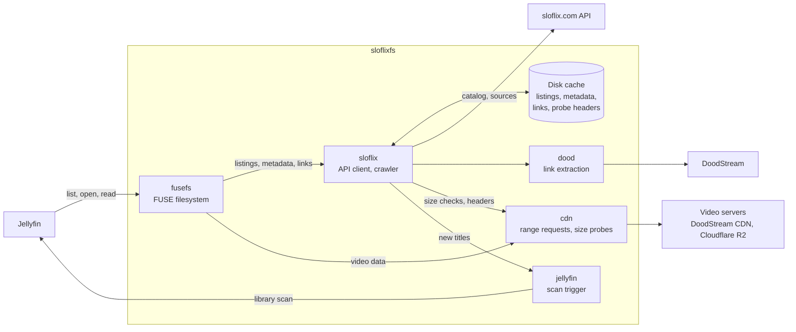

# sloflixfs

A read-only FUSE filesystem that presents the [sloflix.com](https://www.sloflix.com/) catalog as a Jellyfin media library, streaming video on demand.

[](https://github.com/Lenart12/sloflixfs/actions/workflows/ci.yml)
[](https://github.com/Lenart12/sloflixfs/tags)
[](https://hub.docker.com/r/lenart12/sloflixfs)
[](https://hub.docker.com/r/lenart12/sloflixfs/tags)
[](go.mod)
[](LICENSE)

> [!NOTE]
> This is an unofficial project, not affiliated with sloflix. It uses the site's private web API, which may change or block it at any time. You need your own sloflix account.

```
Movies/
  Runner (2026)/
    Runner (2026).mp4
    Runner (2026).sl.vtt          # Slovenian subtitles, when available
    movie.nfo                     # title, plot, genres, artwork from sloflix
Shows/
  Lanterns (2026)/
    tvshow.nfo
    Season 01/
      Lanterns (2026) S01E01.mp4
      Lanterns (2026) S01E01.sl.vtt
```

## Contents

- [Features](#features)
- [Installation](#installation)
- [Building from source](#building-from-source)
- [Configuration](#configuration)
- [How it works](#how-it-works)
- [Limitations](#limitations)
- [Troubleshooting](#troubleshooting)
- [Development](#development)

## Features

- **Streams on demand.** Video is read from the provider with HTTP range requests; only metadata is stored locally.
- **Jellyfin layout.** `Name (Year)` folders, `SxxEyy` episodes, `.sl.vtt` subtitles, and NFO files with sloflix's title, plot, genres and artwork, so titles TMDB can't match still have metadata.
- **Lists only what plays.** A background crawler verifies every title, and library scans read only the cache, so they are fast and never wait on upstream.
- **Fast first probe.** New titles' file headers are kept ready for Jellyfin's first probe.
- **Playback first.** Opening a file jumps the API queue, skips the concurrency limit and has DoodStream lookups reserved for it.
- **Tracks upstream changes.** Replaced files and changed subtitles get a new modification time, so Jellyfin re-probes them.
- **Protects your library.** Upstream glitches can't make Jellyfin delete titles or their watch history.

## Installation

sloflixfs runs on Linux and needs FUSE (`/dev/fuse`). Pick one of:

- [Docker Compose](#docker-compose): sloflixfs and Jellyfin together (recommended).
- [Docker](#docker): sloflixfs only, for an existing Jellyfin.
- [Go](#go): a native binary.

Then [set up Jellyfin](#setting-up-jellyfin).

### Docker Compose

Download [`compose.yml`](compose.yml) into a new directory, set your sloflix credentials in it, and start the stack:

```sh
mkdir sloflixfs && cd sloflixfs
curl -fsSLO https://raw.githubusercontent.com/Lenart12/sloflixfs/main/compose.yml
nano compose.yml        # set SLOFLIX_USER and SLOFLIX_PASS
docker compose up -d
```

Jellyfin is then available at http://localhost:8096. Optional settings are listed, commented out, in the file's `environment` section.

The file holds your password, so keep it private (`chmod 600 compose.yml`). To update, run `docker compose pull && docker compose up -d`.

How the setup works:

- The `sloflix` container creates the FUSE mount itself. It needs `/dev/fuse` and `SYS_ADMIN`, and on Ubuntu hosts it runs AppArmor-unconfined.
- The mount appears on the host at `/mnt/sloflix/library`. Jellyfin sees the same directory, and starts only once the mount passes its health check, so it never scans an empty folder.
- The parent directory is bound instead of the mount itself, so a mount left behind by a crash can't block startup. sloflixfs clears it when it starts.

### Docker

To add sloflixfs to an existing Jellyfin, run the container alone:

```sh
sudo mkdir -p /mnt/sloflix
docker run -d --name sloflix --restart unless-stopped \
  --device /dev/fuse --cap-add SYS_ADMIN --security-opt apparmor:unconfined \
  -e SLOFLIX_USER=your-username -e SLOFLIX_PASS=your-password \
  -v sloflix-cache:/cache \
  --mount type=bind,source=/mnt/sloflix,target=/mnt/sloflix,bind-propagation=rshared \
  lenart12/sloflixfs:latest
```

The library appears on the host at `/mnt/sloflix/library`. If Jellyfin runs in a container, bind `/mnt/sloflix` into it with `rslave` propagation, as [`compose.yml`](compose.yml) does.

### Go

Requires Go 1.25+ and FUSE 3 (`fusermount3`).

```sh
go install github.com/Lenart12/sloflixfs@latest
SLOFLIX_USER=your-username SLOFLIX_PASS=your-password sloflixfs -mount ~/sloflix
```

The binary is installed to `$(go env GOPATH)/bin`. To let another user read the mount (a `jellyfin` service account, or a container), add `user_allow_other` to `/etc/fuse.conf` and pass `-allow-other`. Stop the process or run `fusermount3 -u ~/sloflix` to unmount.

### Setting up Jellyfin

1. Add two libraries. With Docker Compose the folders are:

   | Library type | Folder |
   |---|---|
   | Movies | `/media/sloflix/library/Movies` |
   | Shows | `/media/sloflix/library/Shows` |

   Otherwise use `Movies` and `Shows` under the mount as Jellyfin sees it.

2. In each library's settings, turn off **Trickplay image extraction**, **Chapter image extraction** and **Real-time monitoring**. The first two read whole files from upstream; the third doesn't work on FUSE. For the same reason, turn off or exclude these libraries from plugins that analyze file contents, such as **Intro Skipper**.

3. Optionally, let sloflixfs start library scans when new titles are ready: create an API key in Jellyfin (Dashboard → API Keys) and set `SLOFLIX_JELLYFIN_URL` and `SLOFLIX_JELLYFIN_KEY` (see [Jellyfin scans](#jellyfin-scans)).

Titles appear as the crawler verifies them, newest first, so a new installation fills in over a few days (see [Crawler](#crawler)). For a quick trial, set `SLOFLIX_LIMIT_MOVIES=20` and `SLOFLIX_LIMIT_SHOWS=2` to list only the newest titles.

## Building from source

```sh
git clone https://github.com/Lenart12/sloflixfs.git
cd sloflixfs
go build -o sloflixfs .
```

To build the image from source instead of pulling it, set your credentials in [`compose.yml`](compose.yml) and run:

```sh
docker compose up -d --build
```

## Configuration

Every option is a flag or an environment variable. The variable name is `SLOFLIX_` followed by the flag name in capitals, with `-` written as `_`. Flags take precedence.

| Flag | Environment | Default | Description |
|---|---|---|---|
| `-mount` | `SLOFLIX_MOUNT` | required | Mountpoint; created if missing. |
| `-user`, `-pass` | `SLOFLIX_USER`, `SLOFLIX_PASS` | required | sloflix credentials. Use the environment for the password, since command-line arguments are visible to other users. |
| `-cache` | `SLOFLIX_CACHE` | `~/.cache/sloflixfs` | Cache directory (`/cache` in Docker). |
| `-refresh` | `SLOFLIX_REFRESH` | `12h` | How long catalog, season and episode listings are cached. |
| `-revalidate` | `SLOFLIX_REVALIDATE` | `168h` | How often each title is rechecked in the background. |
| `-probe-cache` | `SLOFLIX_PROBE_CACHE` | `500` | Maximum number of saved file headers for new titles (`0` turns it off). See [Probe cache](#probe-cache). |
| `-rate` | `SLOFLIX_RATE` | `1` | Maximum API requests per second. |
| `-concurrency` | `SLOFLIX_CONCURRENCY` | `3` | Maximum background requests in flight. Playback is exempt. |
| `-jellyfin-url` | `SLOFLIX_JELLYFIN_URL` | off | Jellyfin's address, such as `http://jellyfin:8096`. Turns on [automatic scans](#jellyfin-scans). |
| `-jellyfin-key` | `SLOFLIX_JELLYFIN_KEY` | | Jellyfin API key. |
| `-jellyfin-path` | `SLOFLIX_JELLYFIN_PATH` | `/media/sloflix/library` | The mount's path as Jellyfin sees it. Libraries under it are scanned. |
| `-allow-other` | `SLOFLIX_ALLOW_OTHER` | `false` | Let other users access the mount. |
| `-limit-movies`, `-limit-shows` | `SLOFLIX_LIMIT_MOVIES`, `SLOFLIX_LIMIT_SHOWS` | `0` (all) | List and crawl only the newest N titles, for testing. |

In Docker, set options as environment variables. The image sets the mount, the cache and `-allow-other` itself.

## How it works



Directory listings are served from the disk cache only. Upstream is contacted by the background crawler, and when a file is opened and read.

### Crawler

A title is listed only after the background crawler has checked that it plays. A check is one API call and one small CDN request for the file size, plus a DoodStream lookup for titles that have only a DoodStream embed. New titles are checked first, newest first, then every title is rechecked about once a week (`-revalidate`).

With an empty cache, the library fills in over a few days, because DoodStream lookups are limited (see [Limitations](#limitations)). Show and season listings are fetched in batches of up to 5 minutes, with titles checked in between.

### Playback

Opening a file costs one API call for a stream link, which is then reused for 7h30, also across restarts. Reads come from a single HTTP range response per open file, which reconnects only on seeks. Expired links and stalled connections are renewed automatically.

### Probe cache

Jellyfin probes each new file once to read its format. For 7h30 after the crawler checks a title, that probe uses the link the crawler kept. If the title is still unprobed an hour before the link expires, sloflixfs saves the start of the file instead: through the MP4 index, about 10–16 MB. The saved header is deleted once Jellyfin has probed the file, or after 3 days. At the default of 500 titles, the cache can use up to about 8 GB.

Beyond the limit, or with `-probe-cache 0`, a probe needs a fresh link. For a DoodStream-only title that means a DoodStream lookup, so a scan probing many such titles at once can exceed the lookup limit. The affected probes fail after waiting up to a minute, and Jellyfin retries them on a later scan.

### Jellyfin scans

FUSE has no change notifications, so Jellyfin can't see new titles until its next scheduled scan. With `-jellyfin-url` set, sloflixfs starts a scan of the libraries under `-jellyfin-path` once new titles are listed:
- at most once an hour;
- immediately when the probe cache is half full, so new titles keep getting saved headers;
- never while Jellyfin is already scanning.

### Caching

| Data | Stored | Refreshed |
|---|---|---|
| Login token | disk | when missing or rejected |
| Catalog, season and episode listings | memory and disk | by the crawler after `-refresh`; directory listings always use the cached copy |
| File size, subtitle and plot per title | disk | on open, and by the crawler every `-revalidate` |
| Stream links | disk | after 7h30, or when the CDN rejects one |
| Subtitle files | disk | in the background, revalidated by ETag |
| File headers for Jellyfin's first probe | disk | deleted once probed, or after 3 days |
| Video data | not cached | |

### Safeguards

- **Shrinking listings:** a refreshed listing with more than 10% fewer entries is treated as an upstream glitch. The previous listing is kept, and the refresh retried hourly, unless the drop persists for 24 hours.
- **Removed titles:** a title that used to play stays listed for 24 hours after upstream first reports it gone, so a single bad response can't make Jellyfin drop it and its watch history.
- **Failing titles:** a title that has never played and fails on its own, such as on an unreachable video server, is retried after an hour, then twice as long after each failure, up to about 5 days. A failure that affects every title, such as the sloflix API or DoodStream being down, is retried after an hour.
- **Titles without a source** are rechecked every `-refresh`, backing off the same way.
- **Broken uploads:** files under 5 MB are hidden like titles without a source.

## Limitations

- **Bandwidth.** The CDN serves about 550 kB/s per connection, roughly 2–3× a typical bitrate. That is enough for direct play, but slow for anything that reads whole files.
- **Supported sources.** sloflix's direct links (DoodStream CDN or presigned URLs such as Cloudflare R2) and DoodStream embed and download links, which are resolved through a working DoodStream mirror. StreamP2P sources are not supported.
- **Availability.** In October 2026, about 12% of the catalog was not playable and therefore not listed: 8% had only deleted or unsupported sources, 3% were on video servers that were down, and 1% had been deleted from their video server. Titles on unreachable servers are retried and appear once their server returns.
- **DoodStream lookup limit.** DoodStream allows 15 lookups per IP address per 5 minutes, then shows a captcha for about 5 minutes. Every machine behind the same public IP shares the limit. sloflixfs reserves 3 lookups for playback and spreads the crawler's lookups evenly over the rest. The limit affects only titles whose only source is a DoodStream embed.
- **Titles.** sloflix provides only Slovenian and English titles. NFO files use the Slovenian one; the original-language title comes from TMDB when Jellyfin matches the item.
- **Expired certificates.** Some DoodStream video servers still use a `*.cloudatacdn.com` certificate that expired on 2026-08-01. sloflixfs accepts an expired certificate for that domain only, and only if its chain and hostname are otherwise valid. Each accepted host is logged once.
- **Bot protection.** Requests use a browser User-Agent to pass Cloudflare. Stricter bot protection on sloflix would stop sloflixfs from working.

## Troubleshooting

**Reading the logs.** Run `docker compose logs -f sloflix`, or `docker logs -f sloflix` for a standalone container. Every API call, DoodStream lookup and size check is one log line, and each closed file logs a summary of its connections.

**A title is missing.** It may not be checked yet, since new titles are checked newest first and a fresh cache takes a few days to fill. If it was checked, the log has a `crawl <id>:` line with the reason:
- `no direct source`: no supported source;
- an unreachable video server: retried with backoff (see [Safeguards](#safeguards)).

**`asks for a captcha` in the log.** The DoodStream lookup limit was exceeded, possibly by another machine on the same network. The lookup is retried later; nothing needs to be done.

**`Transport endpoint is not connected` on the mount.** A previous run crashed and left the mount behind. In Docker, restarting the container clears it. Without Docker, run `fusermount3 -u <mountpoint>` and start sloflixfs again.

## Development

```sh
go vet ./... && go test -race ./...
```

To release a multi-platform image:

```sh
git tag vX.Y.Z && git push origin vX.Y.Z
docker buildx build --platform linux/amd64,linux/arm64 \
  -t lenart12/sloflixfs:X.Y.Z -t lenart12/sloflixfs:latest --push .
```

| Package | Purpose |
|---|---|
| `main.go` | Flags and environment variables, mounting, shutdown |
| `internal/fusefs` | The filesystem: directory tree, file names, NFO files, streaming file handle |
| `internal/sloflix` | The sloflix API, listing and metadata caches, probe cache, background crawler |
| `internal/cdn` | Video server requests, size probes, certificate checks, host health |
| `internal/dood` | DoodStream link extraction and its rate limit |
| `internal/jellyfin` | Library scan triggers |
| `internal/mp4` | Reading the MP4 index for probe headers |
| `internal/web` | Shared HTTP request helpers |

## License

[MIT](LICENSE)
